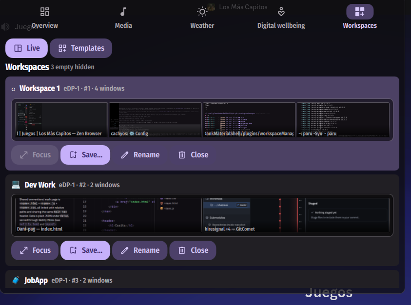

# Niri Workspace Manager

[](https://github.com/garasnote/dms-workspace-manager/actions/workflows/ci.yml)

A [Dux Modular Shell](https://github.com/duxlabs-dev/dux-shell) plugin for
[niri](https://github.com/YaLTeR/niri): name your workspaces, give them an emoji,
and switch between whole *environments* — "Dev Work", "Gaming", "JobApp" — instead
of opening the same five apps by hand every morning.



Named workspaces show up in the bar's workspace indicator as `💻 Dev Work`,
`🎮 Gaming`, and so on.

## What it does

- **Name and label workspaces** — a name and an emoji, applied instantly, visible
  in the bar.
- **Launch templates** — an environment is a list of apps plus the workspace it
  belongs to. Launching it focuses that workspace and starts only what is not
  already open.
- **Save what you have** — snapshot the current workspace into a reusable
  template, reviewing and pruning the apps first.
- **See what is where** — the dash shows a live mini-map per workspace, with the
  real layout from niri, the focused window ringed, and a picture of every window.
- **Jump straight there** — click any window in a mini-map to focus it, even if it
  lives on another workspace.

## Install

Requires DMS 2.1.0 or newer and niri.

From the plugin registry (once listed):

```bash
dms plugins install workspaceManager
```

Manually, from a checkout:

```bash
git clone https://github.com/garasnote/dms-workspace-manager \
  ~/.config/dms/plugins/workspaceManager
dms restart          # a plain `plugins reload` will not pick up new files
```

Optional but recommended for window pictures: `wl-clipboard` (niri hands a
screenshot over through the clipboard).

## Quick start

1. Open the dash: <kbd>Mod</kbd>+<kbd>Ctrl</kbd>+<kbd>W</kbd>, or the launcher
   with `ws`.
2. Put your windows in place, then hit **Save…** on that workspace, prune the app
   list, and name it. That is now a template.
3. Bind it:

```kdl
// ~/.config/niri/config.kdl
Mod+Ctrl+D { spawn "dms" "ipc" "call" "workspaceManager" "activate" "Dev Work"; }
Mod+Ctrl+J { spawn "dms" "ipc" "call" "workspaceManager" "activate" "JobApp"; }
Mod+Ctrl+N { spawn "dms" "ipc" "call" "workspaceManager" "create" ""; }
Mod+Ctrl+W { spawn "dms" "ipc" "call" "dash" "toggle" "plugin_workspaceManager"; }
```

## Templates

Templates live in `templates.json` next to the plugin, and the file is plain and
hand-editable — the dash re-reads it every time it opens.

```json
{
  "version": 1,
  "templates": [
    {
      "name": "Dev Work",
      "emoji": "💻",
      "workspace": "Dev Work",
      "apps": [
        { "name": "zeditor", "cmd": "zeditor" },
        { "name": "gitcomet", "cmd": "gitcomet", "appId": "gitcomet" },
        { "name": "agent", "cmd": "ghostty -e herdr", "appId": "com.mitchellh.ghostty" }
      ]
    }
  ]
}
```

| field | meaning |
|---|---|
| `name` | template name, also the key for `activate` |
| `emoji` | shown in the bar next to the workspace name |
| `workspace` | workspace to create or focus before launching |
| `apps[].cmd` | what to run, through the shell — `ghostty -e tool` works for tools that need a TTY |
| `apps[].appId` | optional, helps matching against open windows |
| `apps[].alwaysLaunch` | always start it, even if a window is already open |
| `apps[].gather` | never start a second copy — move the existing window here instead |

### What "launch" actually does

1. Focus the template's workspace, creating it if needed, and wait until niri
   confirms it.
2. Start the apps that are not on that workspace yet.
3. A few seconds later, fix the result up: a window that opened on the wrong
   workspace is moved here, and an app that refused to open a second window (a
   password manager raising the one it already had) has that window brought over.

Step 3 exists because apps disagree about what a second launch means — some open a
new window, some just raise the old one, and the compositor places the window
wherever it feels like. The plugin checks what really happened rather than
guessing. Turn it off in settings if you would rather handle that yourself.

## The dash

**Live** — one card per workspace: emoji, name, output, window count, a mini-map
of the real layout, and **Focus**, **Save…**, **Rename**, **Close**. Click any
window in a mini-map to focus it. Cards can collapse to a single line if you keep
many workspaces.

**Templates** — every template with what is already open versus what a launch
would start, plus **Launch**, **Launch all** (start everything, ignore what is
running), edit and delete.

**Close** closes the workspace's windows and removes its name. niri has no
"delete workspace" verb, and a named workspace lives on while empty — that is the
closest equivalent.

## Window pictures

Tiles show a real picture of each window, captured when you open the dash and
cached for ten minutes. Nothing is captured while the dash is closed.

niri only exposes a single window's pixels through its own screenshot command,
and that always also copies to the clipboard — so each capture borrows the
clipboard for about 50 ms and puts it back. You will see niri's usual "Screenshot
captured" notification while a batch runs. Turn the feature off in settings and
the tiles fall back to app icons with no clipboard involvement at all.

## Settings

| setting | default | what it does |
|---|---|---|
| Launch templates into their named workspace | on | create and focus the workspace before starting apps |
| Fix up windows after a launch | on | move misplaced windows, adopt windows from apps that will not start twice |
| Window stills | on | real pictures in the mini-map, cached ten minutes |
| Show empty workspaces | off | niri keeps empty filler workspaces; this shows them |
| Compact rows | off | one line per workspace instead of the full preview |

## IPC

Everything the dash does is reachable from a terminal or a keybinding:

```bash
dms ipc call workspaceManager <command> [args]
```

| command | effect |
|---|---|
| `activate <name>` | focus the template's workspace and launch what is missing |
| `launch <name>` / `launchAll <name>` | launch missing apps / launch everything |
| `create [name]` | new workspace, optionally named |
| `name <workspace> <name>` / `rename <from> <to>` | naming |
| `focusId <workspace-id>` / `focusWindow <window-id>` | focus a workspace / a window |
| `closeWorkspace <id> <close-windows>` | remove a workspace (see above) |
| `record <name>` / `previewRecord <name>` / `previewWorkspace <id>` | capture the current session |
| `saveTemplate <json>` / `deleteTemplate <name>` | template CRUD |
| `diff <name>` / `list` / `state` | inspect what a launch would do |
| `showNames <on\|off>` / `syncIcons` / `forgetIcon <name>` | bar indicator |
| `refreshLive` / `pullStills` / `reload` | refresh caches |

## Under the hood

A marker for the impatient: nothing here needs a helper daemon, a build step or a
language runtime. The plugin is QML, talking to niri over its IPC socket and to
DMS through its plugin API.

| file | role |
|---|---|
| `WorkspaceDaemon.qml` | all logic + the `workspaceManager` IPC target |
| `WorkspaceDash.qml` | the "Workspaces" dash tab |
| `WorkspaceLauncher.qml` | `ws` launcher entry |
| `WorkspaceSettings.qml` | settings pane |
| `WorkspacePreview.qml`, `AppChip.qml`, `MarqueeText.qml` | mini-map pieces |
| `templates.json` | your templates |

`bench/` holds the performance harness and its results, `scripts/ci.sh` the checks
CI runs, and `graphify-out/` a knowledge graph of the codebase. None of it is
needed to use the plugin.

## License

MIT.
